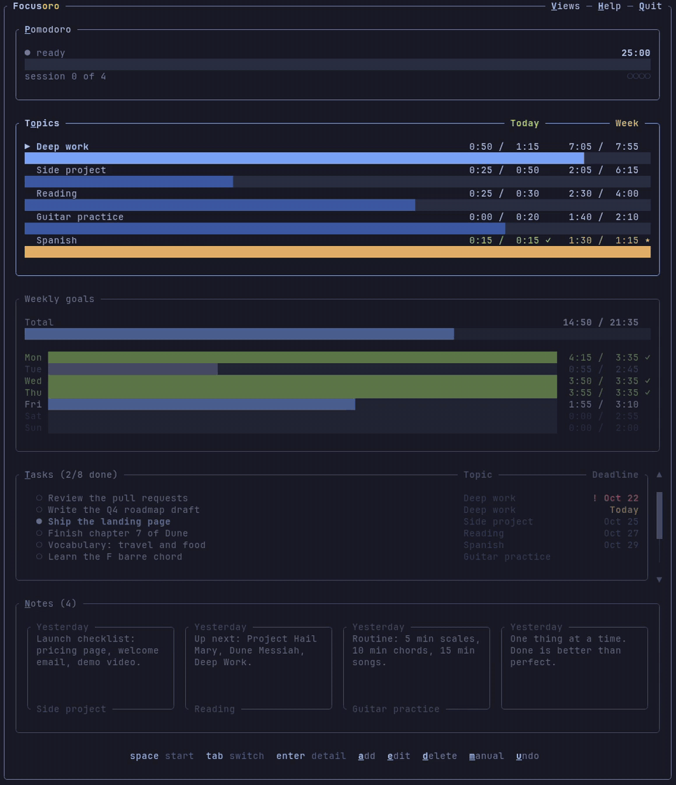

<p align="center"></p>

# Focusoro

**Where focus becomes progress.** Focusoro is a free Pomodoro timer for your
terminal that keeps track of what you work on. You choose how much time each
topic gets a day, and Focusoro keeps the record of every session and of how
close you are to today's and this week's goals. Tasks, notes, a calendar and a
report of your progress are there when you want them. There is no account and
no cloud of ours. Your data is plain files on your computer, or in a folder you choose to
sync with Dropbox, iCloud Drive or another service. It is one small native
program of about 5 MB that uses under 10 MB of memory, with nothing else to
install.

→ **[focusoro.com](https://focusoro.com)**

<p align="center"></p>
<p align="center"><sub>Recorded in a real terminal. The full demo, with the HTML report, is on <a href="https://focusoro.com">focusoro.com</a>.</sub></p>

## Install

On **macOS and Linux**, open a terminal and run

```sh
curl -fsSL https://focusoro.com/install.sh | sh
```

On **Windows**, open PowerShell and run

```powershell
irm https://focusoro.com/install.ps1 | iex
```

Then open a new terminal and type **`focusoro`**. Press `h` inside the app to
see every shortcut.

It is also in these package managers.

| | |
|---|---|
| Homebrew (macOS, Linux) | `brew install orocore/tap/focusoro` |
| Scoop (Windows) | `scoop bucket add focusoro https://github.com/orocore/focusoro` then `scoop install focusoro` |

If you prefer to install it by hand, download the file for your system from
the [latest release](https://github.com/orocore/focusoro/releases/latest),
rename it to `focusoro` and move it to a folder your terminal searches for
programs, such as `~/.local/bin`. `sha256sums.txt` in each release lets you
check that the download is intact.

## Recommended terminals

Focusoro runs in any terminal and looks its best in a modern one, like
Ghostty, iTerm2, WezTerm, Kitty or Alacritty on macOS and Linux, foot on Linux
(Wayland), and Windows Terminal on Windows (the default on Windows 11). These
draw borders and progress bars without gaps and in full color. On older or
modest computers, foot or Alacritty (which also runs on X11) keep everything
light.

The built-in Terminal on macOS works too, but borders look dotted and bars
break into blocks. Setting its character and line spacing to 1 in Settings →
Profiles → Text helps.

## Your own themes

Press `i` then `t` to pick a theme. To add another one, choose **+ Add your
own…** at the end of the list. It opens the `themes` folder (`focusoro --help`
shows where it is). Put a terminal theme file there and open the picker again
to find it in the list. Theme files for Ghostty, Kitty, Alacritty, Windows
Terminal and Xresources work as they are, and you can find hundreds of them
at [iTerm2-Color-Schemes](https://github.com/mbadolato/iTerm2-Color-Schemes).

## On all your computers

Press `i` then `y` and choose a folder that Dropbox, iCloud Drive, OneDrive,
Google Drive, Nextcloud or Syncthing keeps in sync. Every computer that chooses
the same folder shares your topics, history, tasks, notes, dates, quotes and
themes. Your settings stay on each computer. If both this computer and the
folder already have data, you choose which one to keep, and the other is saved
in a backup folder. Choosing Stop syncing in the same window brings the data
back to this computer.

## Where are my files?

- **Exports** (the HTML report, sessions as CSV and the calendar as `.ics`) go
  to `Documents/Focusoro`.
- **Your data** is in `~/.local/share/focusoro` on Linux,
  `~/Library/Application Support/focusoro` on macOS and `%APPDATA%\focusoro`
  on Windows. With Sync on, it is in the `Focusoro` folder inside the folder
  you chose. `focusoro --help` shows the paths.

## Update

Run the install command again. It replaces the app with the latest version
and keeps your data. Close Focusoro first.

| Installed with | Update with |
|---|---|
| The macOS / Linux command | `curl -fsSL https://focusoro.com/install.sh \| sh` |
| The Windows command | `irm https://focusoro.com/install.ps1 \| iex` |
| Homebrew | `brew upgrade focusoro` |
| Scoop | `scoop update focusoro` |

`focusoro --version` shows the version you have.

## Uninstall

```sh
curl -fsSL https://focusoro.com/install.sh | sh -s -- --uninstall
```

```powershell
& ([scriptblock]::Create((irm https://focusoro.com/install.ps1))) -Uninstall
```

Your data is kept. Delete its folder to remove it too.

## Problems or ideas

Open an [issue](https://github.com/orocore/focusoro/issues), or write to
[info@focusoro.com](mailto:info@focusoro.com).

---

Focusoro by Orocore is a terminal app for macOS, Linux and Windows.

This repository publishes Focusoro's releases, installers, the website
(`docs/`, served at focusoro.com) and the Scoop bucket (`bucket/`). Focusoro is
free to use. See [LICENSE](LICENSE) for the terms and
[THIRD-PARTY-NOTICES](THIRD-PARTY-NOTICES) for the open source software it
includes.

Focusoro is written in C++ with
[FTXUI](https://github.com/ArthurSonzogni/FTXUI) and
[nlohmann/json](https://github.com/nlohmann/json), thanks to their authors.
